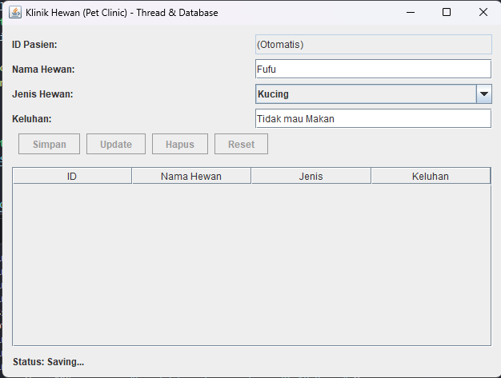
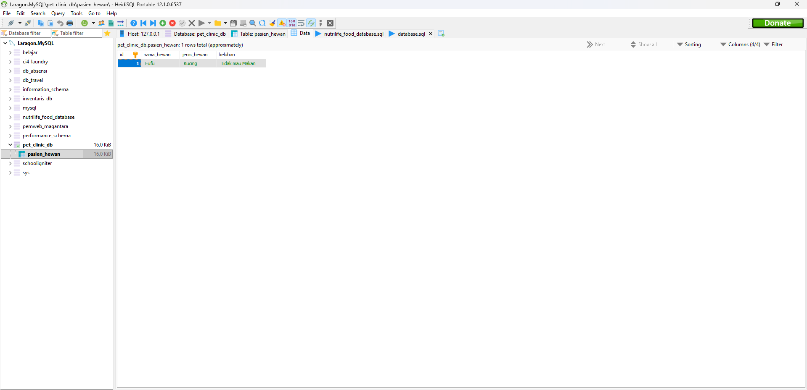

# Klinik Hewan (Pet Clinic) — Java Thread & Database

Aplikasi Java Swing sederhana untuk mencatat data pasien klinik hewan (CRUD) ke database MySQL menggunakan pola **DAO** dan **Thread**.

## Isi Proyek
* `src/DBConnection.java` — Koneksi JDBC ke database `pet_clinic_db`.
* `src/PasienHewan.java` — Model data pasien (`id`, `namaHewan`, `jenisHewan`, `keluhan`).
* `src/PasienHewanDAO.java` — Operasi CRUD (`Connection`, `PreparedStatement`, transaksi `commit`/`rollback`, dan `ResultSet`).
* `src/PetClinicFrame.java` — GUI Swing dengan pola: klik tombol -> nonaktifkan tombol -> tampilkan `Status: Saving...` -> jalankan database di `Thread` -> perbarui UI lewat `SwingUtilities.invokeLater`.
* `src/Main.java` — Titik masuk aplikasi.
* `lib/mysql-connector-j-26.10.0.jar` — Driver MySQL Connector/J.
* `database.sql` — Skrip pembuatan database `pet_clinic_db` dan tabel `pasien_hewan`.

## Cara Menjalankan
1. Nyalakan MySQL (Laragon), lalu jalankan `database.sql`.
2. Pastikan `lib/mysql-connector-j-26.10.0.jar` sudah masuk ke **JAVA PROJECTS -> Referenced Libraries** di VS Code.
3. Jalankan `src/Main.java` di VS Code, atau lewat PowerShell:
   ```powershell
   javac -cp "lib/mysql-connector-j-26.10.0.jar" -d bin src/*.java
   java -cp "bin;lib/mysql-connector-j-26.10.0.jar" Main
   ```

## Screenshot
### 1. Proses Menyimpan (`Status: Saving...`)


### 2. Hasil CRUD pada Tabel

